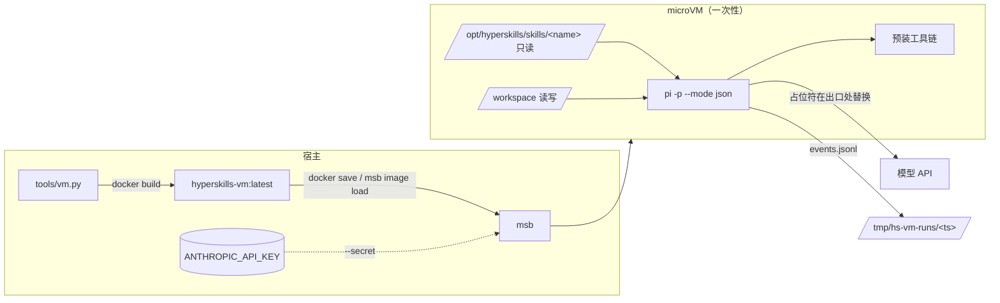

# skill 测试 VM

在 [microsandbox](https://docs.microsandbox.dev/)（msb）的 microVM 里用
[pi](https://pi.dev/) 跑 skill 测试，让评测与本机环境彻底分开。

## 为什么要 VM

宿主上的评测子进程会继承本机 agent 的全部状态：全局 `AGENTS.md`、已安装的 skill、
advisor、MCP、记忆，以及 agent 在测试中写下的文件。这些都会混进「有 skill / 无 skill」
的对照里，日志 0078 记录的 advisor 干扰就是一例。VM 里只有镜像内容加上本次挂载的东西：

- 没有宿主的 agent 配置、上下文文件或 skill 目录；基线运行连被测 skill 都看不到。
- 被测 skill 以**只读**方式挂载，agent 改不动仓库。
- 工作区是宿主 `/tmp` 下的一次性目录，每次运行都是全新 VM（`msb run` 不带 `--name`）。
- 模型密钥由 msb `--secret` 注入：VM 里只有占位符，msb 只在发往 API 主机的 HTTPS
  请求里把它换成真实值，VM 里的进程读不到密钥本身。



## 目录结构

```
vm/
├── README.md                     # 本文
├── local.env.example             # 凭据模板；复制为 vm/local.env（已 gitignore）
└── image/                        # 镜像构建上下文
    ├── Dockerfile                # 分层构建；各层版本号用 ARG 钉住
    ├── provision/
    │   ├── lib.sh                # 共享函数：架构名、下载、sha256 校验
    │   ├── 10-system.sh          # apt：基础/构建/数据库/媒体办公/JDK/PHP/docker、gh、gcloud、agent 用户
    │   ├── 20-binaries.sh        # 上游二进制：Node、Go、uv、Terraform、kubectl、Helm、yq、…、.NET
    │   ├── 30-node.sh            # pi、npm 全局 CLI、Playwright Chromium
    │   └── 40-user.sh            # 以 agent 身份：/opt/venv Python 库、uv tools、Rust
    └── rootfs/                   # 原样复制进镜像的文件
        ├── home/agent/.pi/agent/settings.json   # pi 默认：anthropic/claude-opus-5、medium
        └── usr/local/bin/hs-verify-tools        # VM 内工具自检
tools/vm.py                       # 宿主侧入口：build / verify / run / shell / clean
```

层的顺序按变动频率由低到高排列：改 `rootfs/` 不会触发重装工具，改某个 ARG 只让该层
及其后续层重建。

## 前置条件

- Linux + KVM（或 Apple Silicon macOS）上装好 `msb`：`msb doctor` 全绿。
- `docker`（仅用于构建镜像；运行时不需要）与 `uv`。
- 模型凭据：复制 `vm/local.env.example` 为 `vm/local.env` 并填写，或直接导出同名环境变量。

  | 变量 | 必填 | 说明 |
  |---|---|---|
  | `ANTHROPIC_API_KEY` | 是 | 只在宿主进程环境里存在 |
  | `HS_VM_ANTHROPIC_BASE_URL` | 否 | Anthropic 兼容代理根地址（不含 `/v1`）；`--secret` 自动绑定到它的主机名 |

## 用法

```bash
uv run tools/vm.py build                 # 构建并导入 msb；本机实测首次约 6 分钟（视网络），之后走层缓存
uv run tools/vm.py verify                # 一次性 VM 里跑 hs-verify-tools
uv run tools/vm.py verify --services     # 另外实际启动 PostgreSQL / Redis / dockerd
```

一次性运行（评测原语）：

```bash
# 有 skill：只挂载 office，pi 用 --no-skills --skill 只加载它
uv run tools/vm.py run --skill office --workspace skills/office/evals/files \
  "List the fillable fields in intake-form.pdf"

# 基线：不挂载任何 skill，其余参数相同
uv run tools/vm.py run --workspace skills/office/evals/files \
  "List the fillable fields in intake-form.pdf"
```

产物在 `/tmp/hs-vm-runs/<时间戳>/`（`--out` 可改）：

| 文件 | 内容 |
|---|---|
| `events.jsonl` | pi `--mode json` 的原始事件流，与 `tools/run_evals.py` 解析的事件同构（`agent_end`、`tool_execution_*`） |
| `stderr.log` | pi 与 msb 的诊断输出 |
| `meta.json` | 退出码、耗时、模型、思考档、挂载的 skill、pi 参数 |
| `workspace/` | VM 内 `/workspace` 的最终状态，agent 产出的文件都在这里 |
| `models.json` | 注入 VM 的 pi provider 配置（不含密钥） |

默认参数与 `tools/run_evals.py` 一致：`anthropic/claude-opus-5`、`medium`、单场景 900 秒；
VM 规格 4 vCPU / 8G 内存 / 32G 可写根盘，均可用 `--cpus`、`--memory`、`--root-disk` 调整。

交互开发：

```bash
uv run tools/vm.py shell                 # 常驻 VM hs-dev；仓库全部 skill 只读挂到 ~/.agents/skills
pi                                       # 在 VM 里直接用，skill 可被发现
uv run tools/vm.py shell --recreate      # 镜像更新后重建
uv run tools/vm.py clean                 # 删除本工具创建的全部 sandbox（--image 连镜像一起删）
```

退出 shell 后 `hs-dev` 仍在运行，装过的东西都保留；不用时 `msb stop hs-dev`。

VM 内 agent 以 `agent`（uid 1000，免密 sudo）运行，工作目录 `/workspace`；网络为 msb 默认的
公网出站，agent 可以自行 `npm install`、`pip install`、`apt-get install`。服务不自启：
`sudo service postgresql start`、`sudo service redis-server start`、`sudo dockerd &`
（三者都由 `verify --services` 实测可在 VM 内启动；dockerd 在 VM 里退化为 `vfs` 存储驱动，
能用但构建大镜像慢、占盘多）。

## 预装工具

`hs-verify-tools` 逐项执行下表工具的版本命令，是这份清单的可执行版本；增删工具时两处一起改。

| 类别 | 工具 | 主要服务的 skill |
|---|---|---|
| agent | pi | 全部 |
| 基础 | git、gh、curl、jq、yq、ripgrep、fd、tree、shellcheck、shfmt、tmux、strace、gdb、valgrind、graphviz | git-workflow、github、debugging、linux-ops |
| C/C++ | gcc、clang/clangd/clang-format/clang-tidy、lldb、cmake、ninja、meson | cpp |
| JS/TS | Node 24、npm、pnpm、yarn、bun、tsc、tsx、prettier、eslint、pyright、playwright + Chromium、wrangler | typescript、react、vue、svelte、astro、nodejs-backend、web-testing、html-deck、cloudflare、chrome-extension、frontend-design |
| Python | 系统 3.13 + `/opt/venv`（pandas、polars、duckdb、openpyxl、python-docx、python-pptx、pypdf、fastapi、sqlalchemy、mcp、openai、anthropic 等）、uv、ruff、mypy、pre-commit、semgrep | python、fastapi、data-analysis、ai-engineering、mcp-server、office、security-review |
| 其他语言 | Go、Rust（rustup stable + clippy/rustfmt）、JDK 21 + Maven + Gradle、.NET 10 SDK、PHP 8 + Composer、Foundry | go、rust、tauri、java-spring、csharp-dotnet、laravel、solidity-web3 |
| 数据 | sqlite3、duckdb、PostgreSQL（服务端 + psql）、Redis、mongosh | sqlite、postgres、redis、mongodb |
| 媒体办公 | ffmpeg、ImageMagick、poppler、qpdf、Ghostscript、pandoc、LibreOffice（Writer/Calc/Impress 无界面）、Noto CJK 字体 | media-processing、office、generative-media、technical-writing |
| 容器与云 | docker（dockerd + CLI + buildx + compose）、hadolint、trivy、gitleaks、kubectl、Helm、Terraform、AWS CLI v2、Azure CLI、gcloud | containers、terraform、aws、azure、gcp、observability |

**刻意不装**：Xcode/Apple 工具链（Linux 上不可用）、Android SDK 与 Flutter、Unity、Unreal、
Godot、DevEco（HarmonyOS）、MongoDB 与 Elasticsearch 服务端、CUDA/PyTorch。它们或在 Linux
VM 里无法运行，或单项就有数 GB；需要时让 agent 在 VM 里现装，或在 provision 里新增一层。

## 维护

- **升级版本**：改 `vm/image/Dockerfile` 里对应 ARG，或临时
  `uv run tools/vm.py build --build-arg PI_VERSION=x.y.z`。上游提供 sha256 的下载都在
  `20-binaries.sh` 里校验，新增下载沿用 `fetch` + `check_sha256`。
- **新增工具**：apt 有足够新的版本就加到 `10-system.sh`；否则按来源放进 20/30/40 层；
  装到 agent 家目录的放 `40-user.sh`。随后在 `hs-verify-tools` 加一行并更新上表。
- **重建后**：`uv run tools/vm.py verify --services` 全部 `ok` 才算镜像可用；
  常驻的 `hs-dev` 不会自动换新镜像，用 `shell --recreate`。
